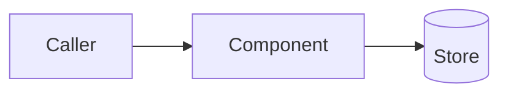

<!-- GENERATED by build/generate.py from core/skills/explain/SKILL.md. Edit the source, then run: python build/generate.py -->
# Explain a component

## 1. Scope
- Restate what you are explaining in one sentence. If the request is ambiguous (e.g. "explain auth"), pick the most likely meaning and say which one you picked, or ask if the guess would be weak.
- Read AGENTS.md, the README and any docs, ADRs or design notes that cover the area first.

## 2. Trace (don't guess)
- Find the entry points (CLI command, route, hook, public function, event handler) and follow the calls and imports from there.
- At each boundary between components, note what crosses it: the inputs, the outputs, their shape, and any state that is read or written.
- Read the related config and tests. Tests show the intended behaviour and the edge cases.
- To find the rationale, look at comments, docs, and `git log --follow` / `git blame` on the key files. Commit messages often say why.
- Stop once every section below is backed by evidence. Don't tour the whole codebase.

## 3. Write the explanation
Answer in chat with this structure. Cite `path:line` for every claim about flow or patterns.

~~~markdown
# How <component> works
**TL;DR:** <two or three sentences>

## Components
- `path`: <its role, one line>

## Data flow
1. <step>: <what moves from A to B, and in what shape> (`path:line`)
2. ...
<Include error and edge paths when they matter.>

## Architecture diagram

## Design patterns
- **<Pattern>**: <where> (`path:line`). <What it buys here.>

## Why this design
- **Chosen:** <approach>, because <reason>. (Source: comment / doc / commit `<sha>` / inferred)
- **Alternatives:** <alternative>: <why it fits worse here, in terms of complexity, performance, coupling or testability>.
- **Costs:** <what this design makes harder, and when it would stop fitting>.
~~~

Diagram guidance:
- Use `flowchart` for structure and `sequenceDiagram` when the order of calls or messages matters.
- Draw the real components and edges, labelled with what flows along them. Don't draw generic boxes.
- If a diagram would add nothing (e.g. two boxes and one arrow), leave it out and say so in one line.
- Use an ASCII diagram instead if the user asks for one or the output can't render Mermaid.

## 4. Rules
- Scale the depth to the question. A small function doesn't need every section at full length, but keep all four topics: data flow, diagram (or why there is none), patterns, and why this design.
- Name only patterns that are actually in the code. "None notable" is a valid answer.
- Label inferred rationale as inferred. Never present a guess about intent as a fact.
- Don't change code while explaining.
- Offer to save the explanation to a file (e.g. `docs/explanations/<topic>.md`), but only write it if the user asks.
